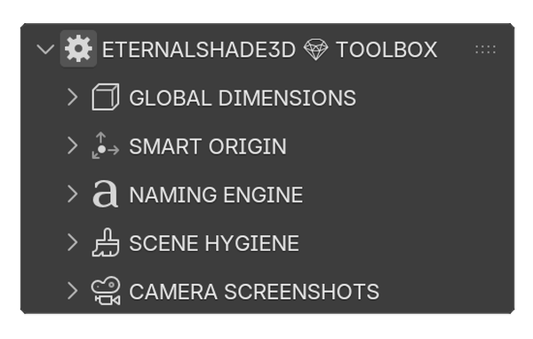
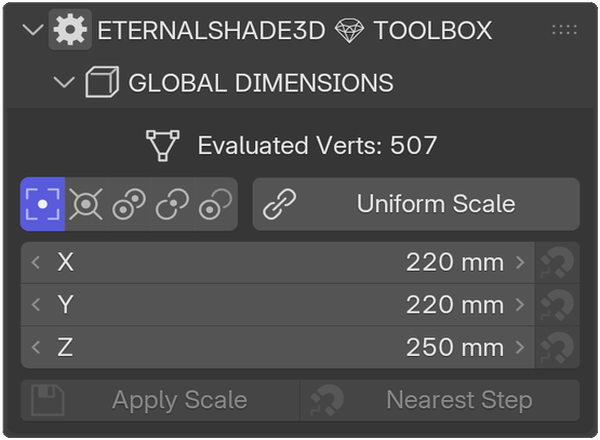
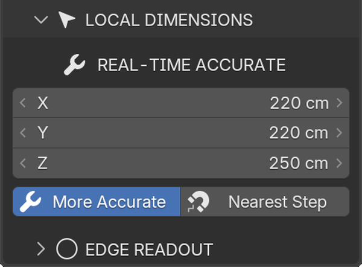
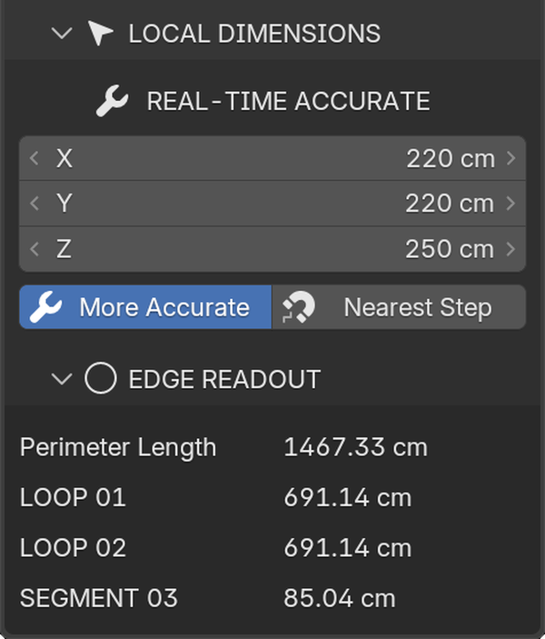
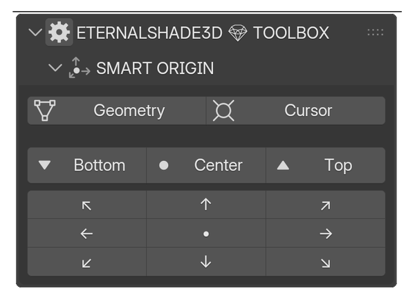
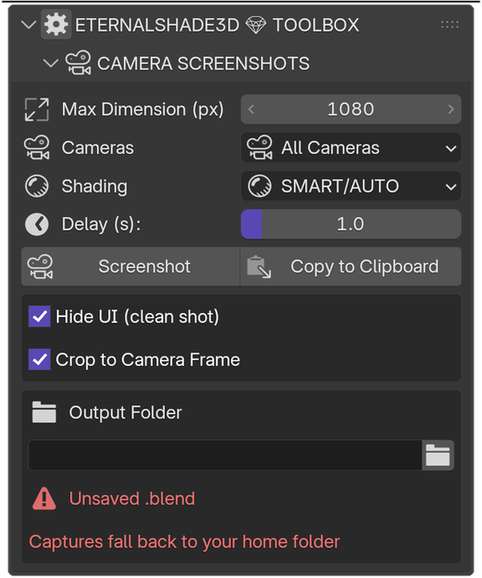
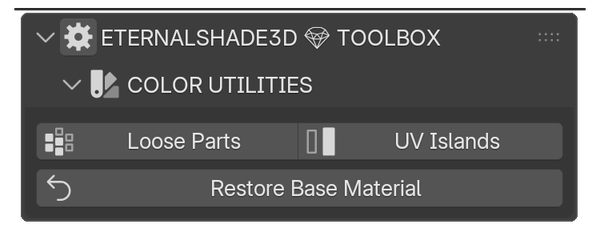
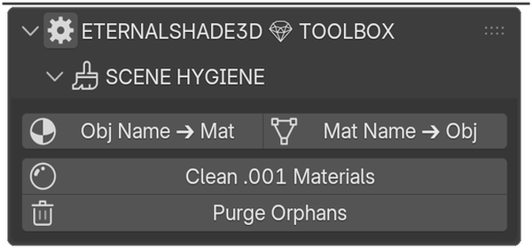
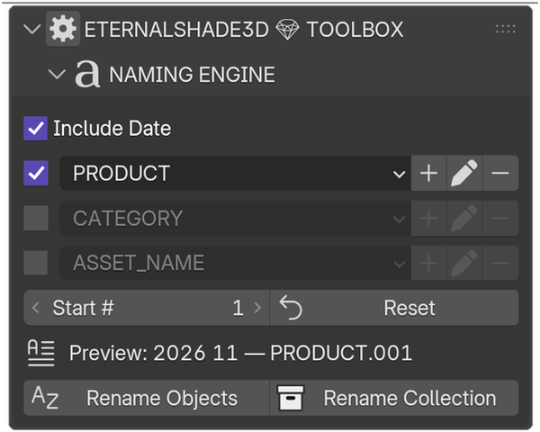

# Eternal Toolbox ◈

  
  
  

  

  

  
  
  

> **Precision Scaling and Evaluated Truth Dimensions for Blender — v1.30.0**

**A modular high-precision toolkit for 3D artists, ArchViz professionals, and Hard-Surface modelers who demand mathematical accuracy.**

Built as independent modules — each panel works on its own, and more drop in over time. Dimensions, Edge Readout and Camera Capture are the mature ones; Naming Engine and Scene Hygiene are still early and will grow.

---

## The Problem

Blender is fantastic, but it leaves you blind to exact dimensions in **Edit Mode** — and in **Object Mode**, it misleads you. Modifiers like Subdivision Surface change your mesh size, but the default transform panel ignores them. You see cage dimensions, not reality.

**The Eternal Toolbox fixes this.**

---

## Features

| Screenshot | Panel | Use it for | Screenshot | Panel | Use it for |
|---|---|---|---|---|---|
|  | **ETERNALSHADE3D 💎 TOOLBOX** | Opens one tab holding every module and shows which are switched on |  | **GLOBAL DIMENSIONS** | Shows the REAL size after all modifiers, not the cage, and rounds the object to your step |
|  | **LOCAL DIMENSIONS *(sub-panel)*** | Measures and rounds only what you selected in Edit Mode, per axis |  | **EDGE READOUT *(sub-panel of LOCAL DIMENSIONS)*** | Names each selected edge set by topology — Perimeter for closed loops, Segment Length for open chains |
|  | **SMART ORIGIN** | Moves the origin to a precise point — compass grid, corner, center or cursor |  | **CAMERA SCREENSHOTS** | Captures every camera in the scene in one pass, straight to clipboard or folder |
|  | **COLOR UTILITIES** | Paints random islands and UV islands to reveal loose parts and overlaps |  | **SCENE HYGIENE** | Removes orphan data, merges duplicate materials, maps objects to materials |
|  | **NAMING ENGINE** | Names objects and collections from saved presets, e.g. 2026 04 - PRODUCT - CHAIR | — | **YOUR NEXT PANEL** | Idea slot — the space where users submit ideas and feedback for the panel that comes next |

This table is just the quick map. The full guide explains every button one by one — read it here: [docs/documentation.md](docs/documentation.md).

---

## ⚡ Built for Speed

| Technique | Benefit |
|-----------|---------|
| **NumPy-powered math** | No viewport freeze, even on dense meshes |
| **Performance Shield** | Auto-throttles calculations above 100k vertices |
| **State caching** | Recomputes only when something actually changes |
| **Geometry Nodes bounding box** | Instant BB calc for multi-million vertex meshes |

---

## Who It's For

- **Hard-surface modelers** — exact dimensions after modifiers
- **ArchViz professionals** — clean, precise measurements
- **Product designers & CAD** — real-world size accuracy
- **Game asset creators** — Edit Mode selection scaling
- **Studio production pipelines** — scene hygiene and naming

---

## Requirements

- **Blender 4.2 through 5.2** (all versions in between)
- Windows, macOS, or Linux

---

## Quick Start

1. **Download** from [Gumroad](https://eternalshade3d.gumroad.com/l/eternal-utility-toolbox), [FairMarket](https://www.fairmarket.land/product/eternal-utility-toolbox) or [BlendSwap](https://blendswap.com/blend/34071)
2. In Blender: **Edit > Preferences > Add-ons > Install...** → select the `.zip`
3. Enable **Eternal Utility Toolbox ◈**
4. Press `N` in the 3D Viewport → open the **ETERNAL** tab

---

## Documentation

Full documentation with detailed feature explanations is available:
- **[GitHub Pages Site](https://eternalshade3d.github.io/EternalShade3D-Toolbox/)** — product overview and guides
- **[docs/documentation.md](docs/documentation.md)** — complete user guide with panel layouts, examples, and FAQ
- **[CHANGELOG.md](CHANGELOG.md)** — full version history

---

## Add-on Preferences

| Setting | Description | Default |
|---------|-------------|---------|
| **Presets File** | Path for naming preset JSON | Blender config directory |
| **Real-time Threshold** | Vertex count before smart-sync debouncing | 100,000 |
| **Enable Debug Logging** | Print internal calculations to console | Off |

---

## License

**This is proprietary software.** The source code is **not** distributed through this repository.

The addon is available exclusively through authorized purchase channels:
- [Gumroad](https://eternalshade3d.gumroad.com/l/eternal-utility-toolbox)
- [FairMarket](https://www.fairmarket.land/product/eternal-utility-toolbox)
- [BlendSwap](https://blendswap.com/blend/34071)

See [LICENSE](LICENSE) for full terms and restrictions.

---

## Repository Contents

This public repository contains **only** marketing and documentation materials:

| File | Purpose |
|------|---------|
| `index.html` | Product landing page (GitHub Pages) |
| `README.md` | This file — product overview |
| `CHANGELOG.md` | Version history |
| `docs/documentation.md` | Full user guide |
| `assets/` | Marketing screenshots |
| `blender_manifest.toml` | Extension metadata (no code) |
| `LICENSE` | Proprietary software license |

The actual addon source code is **not** included in this repository as you can see.

---

*© 2025–2026 EternalShade3D. All rights reserved.*
