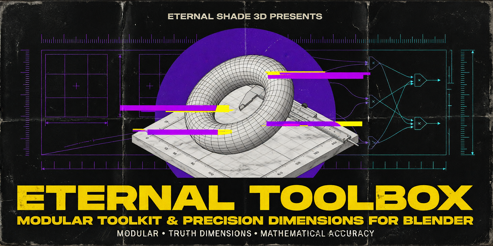

# Eternal Toolbox ◈

  
  
  
  

  

  

  
  
  

> **Precision Scaling and Evaluated Truth Dimensions for Blender — v1.30.0**

**A modular high-precision toolkit for 3D artists, ArchViz professionals, and Hard-Surface modelers who demand mathematical accuracy.**

Built as independent modules — each panel works on its own, and more drop in over time. Dimensions, Edge Readout and Camera Capture are the mature ones; Naming Engine and Scene Hygiene are still early and will grow.

---

## The Problem

Blender is fantastic, but it leaves you blind to exact dimensions in **Edit Mode** — and in **Object Mode**, it misleads you. Modifiers like Subdivision Surface change your mesh size, but the default transform panel ignores them. You see cage dimensions, not reality.

**The Eternal Toolbox fixes this.**

---

## Features

### 📐 Evaluated Truth Dimensions (Object Mode)

See the **real** dimensions of your object — not Blender's guess. The actual size after **ALL** modifiers (Subdivision, Displace, Bevel, Geometry Nodes) — updated in real-time with zero lag. Tested on heavy meshes with millions of verts.

**Scale with precision.** Every operation respects your chosen **Transform Pivot Point** (Bounding Box, 3D Cursor, Individual Origins, Median Point, Active Element). What you see is what you scale.

### ✏️ Edit Mode Selection Dimensions

Now you can see and tweak object dimensions **while inside Edit Mode**. Select any geometry — faces, edges, vertices — and scale it to the exact dimension you want: 30 cm, 200 cm, 4.5 cm. Respects your Transform Pivot Point.

### 🎯 Smart Origin Alignment

Snap origins with mathematical precision:
- **9-point compass grid** — any combination of Top/Center/Bottom, Left/Center/Right, Front/Center/Back
- **Geometry median** — geometric center of all vertices
- **Cursor position** — snap to 3D cursor
- **Selection-based** — snap to center of Edit Mode selection
- Uses a **Geometry Nodes hack** for instant bounding box calculation, even on 10M+ vertex meshes

### 🏷️ Dynamic Naming Engine

Systematic asset management with customizable presets:
- Date prefixing: `2026 04 — PRODUCT — CHAIR — MODEL.001`
- Category, Type, and Name tag system with save/load presets
- Batch rename all selected objects or the active collection
- External JSON preset storage

### 🧹 Scene Hygiene

Keep scenes clean and professional:
- **Clean .001 Materials** — merge duplicates and remap all users
- **Purge Orphans** — remove all orphaned data blocks recursively
- **Obj Name ↔ Mat Name** — sync object and material names

### 🎨 Color Utilities

Visual debugging for complex meshes:
- **Random Loose Parts** — assign distinct colors to separate mesh islands
- **Random UV Islands** — color-code separate UV clusters
- **Restore Base Material** — reset to original materials

### 📸 Camera Screenshots

Capture every camera in your scene in one pass:
- **Batch capture** — render screenshots of all cameras (or a selected list) without manual viewport hopping
- **Clean-shot toggle** — hide viewport overlays and gizmos for presentation-ready frames
- **ESC to stop** — abort a long capture run at any time
- **Shading modes** — AUTO / SOLID / MATERIAL / RENDERED per your needs
- **Per-camera list** — look through any camera directly from the panel. Works in Blender 5.2.

---

## ⚡ Built for Speed

| Technique | Benefit |
|-----------|---------|
| **NumPy-powered math** | No viewport freeze, even on dense meshes |
| **Performance Shield** | Auto-throttles calculations above 100k vertices |
| **State caching** | Recomputes only when something actually changes |
| **Geometry Nodes bounding box** | Instant BB calc for multi-million vertex meshes |

---

## Who It's For

- **Hard-surface modelers** — exact dimensions after modifiers
- **ArchViz professionals** — clean, precise measurements
- **Product designers & CAD** — real-world size accuracy
- **Game asset creators** — Edit Mode selection scaling
- **Studio production pipelines** — scene hygiene and naming

---

## Requirements

- **Blender 4.2 through 5.2** (all versions in between)
- Windows, macOS, or Linux

---

## Quick Start

1. **Download** from [Gumroad](https://eternalshade3d.gumroad.com/l/eternal-utility-toolbox), [FairMarket](https://www.fairmarket.land/product/eternal-utility-toolbox) or [BlendSwap](https://blendswap.com/blend/34071)
2. In Blender: **Edit > Preferences > Add-ons > Install...** → select the `.zip`
3. Enable **Eternal Utility Toolbox ◈**
4. Press `N` in the 3D Viewport → open the **ETERNAL** tab

---

## Documentation

Full documentation with detailed feature explanations is available:
- **[GitHub Pages Site](https://eternalshade3d.github.io/EternalShade3D-Toolbox/)** — product overview and guides
- **[docs/documentation.md](docs/documentation.md)** — complete user guide with panel layouts, examples, and FAQ
- **[CHANGELOG.md](CHANGELOG.md)** — full version history

---

## Add-on Preferences

| Setting | Description | Default |
|---------|-------------|---------|
| **Presets File** | Path for naming preset JSON | Blender config directory |
| **Real-time Threshold** | Vertex count before smart-sync debouncing | 100,000 |
| **Enable Debug Logging** | Print internal calculations to console | Off |

---

## License

**This is proprietary software.** The source code is **not** distributed through this repository.

The addon is available exclusively through authorized purchase channels:
- [Gumroad](https://eternalshade3d.gumroad.com/l/eternal-utility-toolbox)
- [FairMarket](https://www.fairmarket.land/product/eternal-utility-toolbox)
- [BlendSwap](https://blendswap.com/blend/34071)

See [LICENSE](LICENSE) for full terms and restrictions.

---

## Repository Contents

This public repository contains **only** marketing and documentation materials:

| File | Purpose |
|------|---------|
| `index.html` | Product landing page (GitHub Pages) |
| `README.md` | This file — product overview |
| `CHANGELOG.md` | Version history |
| `docs/documentation.md` | Full user guide |
| `assets/` | Marketing screenshots |
| `blender_manifest.toml` | Extension metadata (no code) |
| `LICENSE` | Proprietary software license |

The actual addon source code is **not** included in this repository as you can see.

---

*© 2025–2026 EternalShade3D. All rights reserved.*
